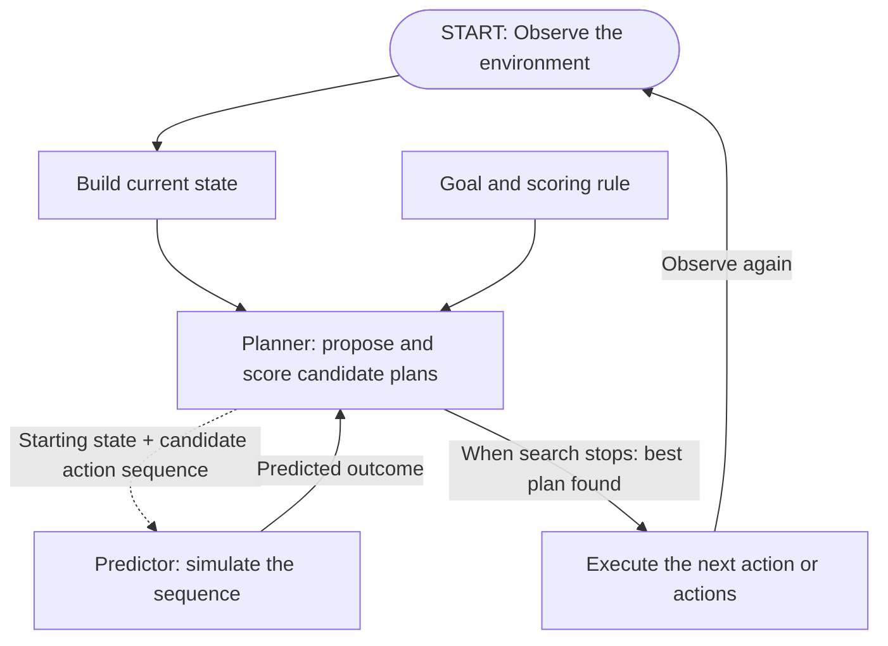

# World Models for Finance

This repository explores where world models are useful in finance. Quantitative development is the first research focus; risk management, investment and asset management, and other financial applications are also in scope. The goal is to share clear explanations, reproducible experiments, and lessons that others can build on.

The central question: **When does a world model improve a financial decision or analysis compared with a simpler baseline?**

## An action-conditioned planning loop

A world model represents how a system might evolve. In the planning setup below, the **Predictor** estimates what would happen under a candidate sequence of actions. The **Planner** compares those hypothetical outcomes against an objective, then selects the next action to apply. New observations inform the next planning round.

This is one use of a world model, not a template for every application. A stress test might simulate adverse scenarios to estimate losses without using a planner or choosing an action.

## Where it might help

- **Quantitative development:** Build and test models of market, portfolio, or execution dynamics in a controlled simulation.
- **Risk management:** Explore how exposures and losses evolve under adverse scenarios.
- **Investment and asset management:** Compare allocation or rebalancing decisions under uncertainty.

For example, a portfolio planner could compare rebalancing now, rebalancing gradually, and doing nothing. It could score each choice on risk and transaction costs across the same simulated market paths, without assuming that its own trades move the market. This is an illustration, not an empirical result.

## How the research will be evaluated

Start with a simple baseline, use data that would have been available at the time, and evaluate on later periods. Report simulation quality separately from whether it improves decisions. Where trading is involved, account for transaction costs and slippage. Document assumptions and limitations, including when the simpler baseline wins.

## Experiments

- **[Execution planning with a market model](experiments/execution-planning/README.md):** buying a fixed quantity before a deadline in a synthetic market. Stages 1 and 2 are complete. In Stage 2, a small learned world model plus a planner beat the best simple rule, capturing 80–98% of the available gain depending on training data. A classical model with the simulator's exact form was slightly better still. Stage 3 tests markets that break the classical model's assumptions. See the [research plan](experiments/execution-planning/PLAN.md).
